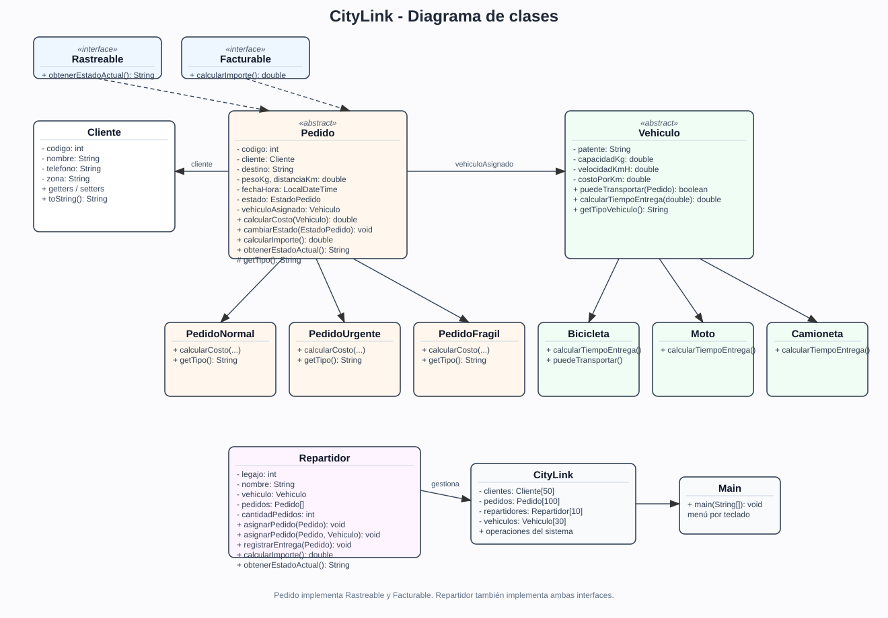
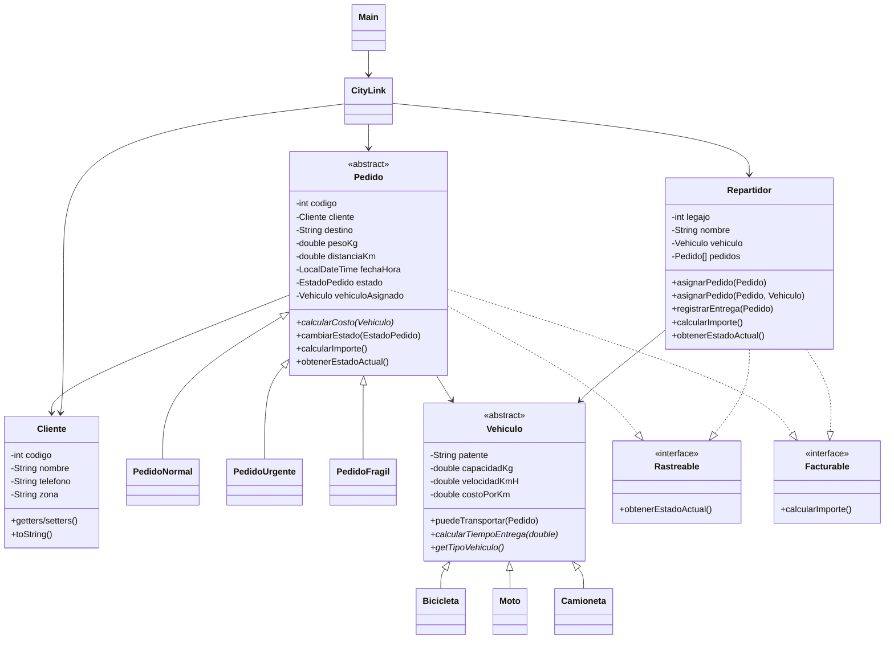

# Proyecto Integrador - CityLink (Entregable 1)

## Integrantes

- Thiago Sturzenegger
- Ángel Ferri
- Walter Rodríguez
- Álvaro Chirino

**Repositorio:** https://github.com/Erebothh/Prog-1

## Qué hace el sistema

CityLink es una aplicación de consola para una empresa de reparto urbano. Permite registrar clientes, repartidores y pedidos, asignar pedidos a los repartidores, cambiar el estado de un pedido y calcular costos, tiempos y comisiones.

Este primer entregable usa **arreglos** para guardar los datos. En el Entregable 2 los reemplazamos por las estructuras de `java.util`.

## Cómo compilar y ejecutar

Desde esta carpeta:

```bash
javac -d out $(find src -name "*.java")
java -cp out app.Main
```

Necesitás Java 17 o superior.

## Paquetes

```text
src/
├── modelo/        -> Cliente, Pedido, Vehiculo, Repartidor, subclases e interfaces
├── excepciones/   -> las cinco excepciones propias
└── app/           -> CityLink (gestor) y Main (menú)
```

Cada archivo empieza con su `package` y usa `import` cuando necesita una clase de otro paquete.

## Diagrama de clases



También está el archivo editable [`docs/diagrama-clases.svg`](docs/diagrama-clases.svg).



## Reglas de negocio implementadas

### Costo

```text
costo = 1000 + (distancia * costoPorKm del vehículo)
```

- Pedido urgente: se multiplica el total por 1.5.
- Pedido frágil: se suman $800.
- Pedido normal: no tiene recargo.

### Tiempo

```text
tiempo = (distancia / velocidad) * 60 + tiempo extra
```

- Bicicleta: sin tiempo extra.
- Moto: 5 minutos.
- Camioneta: 10 minutos.

### Restricciones

- Un pedido no puede superar la capacidad del vehículo.
- Un pedido frágil no puede ir en bicicleta.
- El peso y la distancia tienen que ser mayores que cero.
- El destino no puede estar vacío.
- El código de pedido no se puede repetir.
- El cliente tiene que existir.

### Estados

```text
PENDIENTE -> EN_CAMINO -> ENTREGADO
PENDIENTE -> CANCELADO
```

Cualquier otra transición lanza `EstadoInvalidoException`.

### Comisión

El repartidor gana el 10% de los pedidos que ya entregó.

## Clases principales

### Cliente

Tiene código, nombre, teléfono y zona. Todos los atributos son privados. El constructor vacío y el completo permiten crear clientes de las dos formas. Los setters validan que no falten datos y que el código sea positivo.

### Pedido (abstracta)

Guarda código, cliente, destino, peso, distancia, fecha y hora, estado y vehículo asignado. Tiene el método abstracto `calcularCosto(Vehiculo)` y el método concreto `cambiarEstado`, que revisa que la transición sea válida. Implementa `Rastreable` y `Facturable`.

Las subclases son:

- `PedidoNormal`
- `PedidoUrgente`
- `PedidoFragil`

### Vehiculo (abstracta)

Tiene patente, capacidad, velocidad y costo por kilómetro. El método `puedeTransportar(Pedido)` es concreto y lo heredan las subclases. `calcularTiempoEntrega(double)` es abstracto.

Las subclases son:

- `Bicicleta` (redefine `puedeTransportar` para rechazar frágiles)
- `Moto`
- `Camioneta`

### Repartidor

Tiene legajo, nombre, vehículo y un arreglo de pedidos. Implementa `Rastreable` y `Facturable`. Tiene las dos versiones de `asignarPedido` (sobrecarga) y `registrarEntrega`.

### CityLink

Es el gestor. Guarda los arreglos:

- 50 clientes
- 100 pedidos
- 10 repartidores
- 30 vehículos (para mostrar el polimorfismo con `Vehiculo`)

También tiene las operaciones de alta, búsqueda, asignación, cambio de estado, listados y totales.

### Main

Solamente muestra el menú, lee por teclado y llama a los métodos de `CityLink`.

## Excepciones

| Excepción | Tipo | Cuándo se lanza |
| --- | --- | --- |
| `ClienteNoEncontradoException` | checked | Se busca un cliente que no existe |
| `PedidoInvalidoException` | checked | Peso o distancia no positivos, destino vacío, código repetido |
| `CapacidadExcedidaException` | checked | El pedido supera la capacidad o es frágil y el vehículo es bicicleta |
| `AlmacenamientoLlenoException` | checked | Se intenta agregar a un arreglo lleno |
| `EstadoInvalidoException` | unchecked | Transición de estado no permitida |

Las excepciones checked se lanzan con `throw` y se propagan con `throws`. El menú las captura y muestra el mensaje sin cerrar el programa.

Por ejemplo, al registrar un pedido hay varios niveles de llamada:

```text
Main -> CityLink.registrarPedido -> CityLink.buscarCliente -> throw ClienteNoEncontradoException
```

La excepción sube hasta el `try/catch` del menú.

También hay un bloque `finally` en `Main`, que se ejecuta siempre al salir o si algo falla:

```java
} finally {
    System.out.println("Cerrando CityLink. ¡Hasta luego!");
    teclado.close();
}
```

Si el usuario escribe texto donde va un número, `leerEntero` y `leerDouble` lo detectan y vuelven a pedir el dato. El programa no se corta.

## Menú

```text
1. Registrar cliente
2. Registrar repartidor con su vehículo
3. Registrar pedido
4. Asignar pedido a un repartidor
5. Cambiar estado de un pedido
6. Buscar cliente por código o nombre
7. Listar pedidos con costo y tiempo
8. Consultar estado de un pedido o repartidor
9. Ver importe total y comisiones
10. Salir
```

## Datos de prueba

El sistema arranca con:

- 5 clientes.
- 3 repartidores: Luis Gómez (bicicleta), María Silva (moto) y Jorge Ríos (camioneta).
- 8 pedidos, con normales, urgentes y frágiles.

Algunos pedidos ya están entregados para que se vea la comisión. El pedido 3 quedó `EN_CAMINO`.

| Pedido | Tipo | Cliente | Peso | Distancia | Vehículo | Estado |
| --- | --- | --- | --- | --- | --- | --- |
| 1 | Normal | Ana García | 2 kg | 5 km | BICI-01 | ENTREGADO |
| 2 | Urgente | Bruno Pérez | 5 kg | 8 km | MOTO-01 | ENTREGADO |
| 3 | Frágil | Carla López | 1 kg | 3 km | MOTO-01 | EN_CAMINO |
| 4 | Normal | Diego Martínez | 8 kg | 12 km | CAMI-01 | PENDIENTE |
| 5 | Urgente | Elena Rodríguez | 3 kg | 6 km | MOTO-01 | PENDIENTE |
| 6 | Frágil | Ana García | 4 kg | 7 km | CAMI-01 | PENDIENTE |
| 7 | Normal | Bruno Pérez | 20 kg | 10 km | CAMI-01 | PENDIENTE |
| 8 | Urgente | Carla López | 2 kg | 4 km | BICI-01 | PENDIENTE |

## Pruebas que hice

### Caso normal: listar pedidos

Entrada: opción `7`.

Resultado esperado: lista de los 8 pedidos con costo y tiempo. Por ejemplo:

```text
Pedido 1 [Normal] - ... - Estado: ENTREGADO - Vehículo: BICI-01
   Costo: $1250,00 - Tiempo estimado: 20,0 minutos

Pedido 2 [Urgente] - ... - Estado: ENTREGADO - Vehículo: MOTO-01
   Costo: $2940,00 - Tiempo estimado: 17,0 minutos

TOTAL DE LOS PEDIDOS ASIGNADOS: $23230,00
```

### Caso normal: comisiones

Entrada: opción `9`.

Resultado esperado:

```text
Importe total de los pedidos: $23230,00
Comisiones de los repartidores:
- Luis Gómez: $125,00
- María Silva: $294,00
- Jorge Ríos: $0,00
```

### Caso normal: buscar cliente

Entrada: opción `6`, luego `1` (por código) y código `1`.

Resultado esperado:

```text
Cliente 1 - Ana García - Tel: 555-1111 - Zona: Centro
```

### Caso borde: código de cliente repetido

Entrada: opción `1` y cargar un cliente con código `1`.

Resultado esperado: mensaje de error, pero el menú sigue funcionando.

```text
Error: Ya existe un cliente con el código 1.
El sistema sigue funcionando.
```

### Caso borde: transición inválida

Entrada: opción `5`, pedido `4`, estado `2` (ENTREGADO). El pedido 4 está en `PENDIENTE`.

Resultado esperado:

```text
Error: No se puede pasar de PENDIENTE a ENTREGADO.
El sistema sigue funcionando.
```

### Caso borde: pedido frágil en bicicleta

Entrada: registrar un pedido frágil nuevo y asignarlo al legajo 1 (Luis, bicicleta).

Resultado esperado:

```text
Error: Una bicicleta no puede transportar pedidos frágiles.
El sistema sigue funcionando.
```

### Caso borde: dato no numérico

Entrada: escribir `abc` en una opción del menú.

Resultado esperado:

```text
Eso no es un número entero. Probá de nuevo.
```

### Caso borde: arreglo lleno

No es fácil de probar desde el menú porque habría que cargar 50 clientes, 100 pedidos o 10 repartidores. La validación está en `CityLink` y lanza `AlmacenamientoLlenoException` cuando el contador llega a la capacidad.

### Eliminación con desplazamiento

Aunque el menú del Entregable 1 no tiene una opción de baja, el gestor tiene `eliminarCliente(int)`, que busca la posición, desplaza los siguientes elementos y descuenta el contador para no dejar huecos. No permite eliminar un cliente que tenga pedidos registrados.

### Matriz de prueba manual de pedidos (aporte Álvaro Chirino)

Esta tabla resume una prueba manual del módulo de pedidos. Se probó el **camino feliz** (registrar y asignar un pedido válido) y varios **casos de error** para verificar que el sistema muestra mensajes claros sin cerrarse.

| Caso | Tipo | Datos cargados (entrada) | Resultado obtenido/esperado | Qué verifica |
| --- | --- | --- | --- | --- |
| 1 | Camino feliz | Opción 3. Código: 9. Cliente: 1 (Ana García). Tipo: 1 (Normal). Destino: "San Martín 123". Peso: 2 kg. Distancia: 5 km. | Pedido registrado correctamente con estado `PENDIENTE`. | Alta de pedido con datos válidos y cliente existente. |
| 2 | Camino feliz | Opción 4. Código de pedido: 9. Legajo repartidor: 2 (María Silva, moto MOTO-01). | Pedido 9 asignado a María Silva con vehículo MOTO-01. | Asignación correcta de pedido a repartidor/vehículo. |
| 3 | Error (checked) | Opción 3. Código: 10. Cliente: 99 (no existe). Tipo: 1. Destino: "Belgrano 50". Peso: 1 kg. Distancia: 2 km. | `Error: No se encontró el cliente con código 99.` El menú sigue funcionando. | `ClienteNoEncontradoException`: no se registra pedido sin cliente válido. |
| 4 | Error (checked) | Opción 3. Código: 10. Cliente: 1. Tipo: 1. Destino: "Rivadavia 10". Peso: -3 kg. Distancia: 4 km. | `Error: El peso debe ser mayor que cero.` (o mensaje equivalente de validación). El menú sigue funcionando. | `PedidoInvalidoException`: se rechazan datos inválidos (peso/distancia/destino/código). |
| 5 | Error (checked) | Registrar pedido frágil nuevo (ej. código 11, cliente 2, destino "Centro", 2 kg, 3 km) y asignarlo con opción 4 al legajo 1 (Luis Gómez, bicicleta BICI-01). | `Error: Una bicicleta no puede transportar pedidos frágiles.` El menú sigue funcionando. | `CapacidadExcedidaException`/regla de negocio: un pedido frágil no puede ir en bicicleta. |
| 6 | Error (unchecked) | Opción 5. Pedido: 4 (estado `PENDIENTE`). Nuevo estado: 2 (`ENTREGADO`). | `Error: No se puede pasar de PENDIENTE a ENTREGADO.` El menú sigue funcionando. | `EstadoInvalidoException`: solo se permiten transiciones válidas (`PENDIENTE -> EN_CAMINO -> ENTREGADO` o `PENDIENTE -> CANCELADO`). |

## Tipos de errores

En el proyecto aparecieron errores de compilación, de ejecución y lógicos. Estos son ejemplos reales:

### Error de compilación

Me pasó al principio con `LocalDateTime`: faltaba el `import java.time.LocalDateTime;`. El compilador mostraba `cannot find symbol`. El programa ni siquiera arrancaba.

### Error de ejecución

Un ejemplo es intentar pasar un pedido de `PENDIENTE` a `ENTREGADO`. El programa compila, pero al ejecutar esa opción lanza `EstadoInvalidoException`. También podría aparecer un `NullPointerException` si se llama a `getPatente()` sobre un vehículo que no fue asignado.

### Error lógico

Al principio la comisión sumaba todos los pedidos, incluso los pendientes. El programa funcionaba y no tiraba ninguna excepción, pero el resultado era incorrecto. Lo corregí para que sume solamente los pedidos con estado `ENTREGADO`.

## Declaración de uso de IA

Para este entregable se usó **OpenCode** (agente de IA con el modelo **Big Pickle**) como apoyo para ordenar ideas, revisar errores de compilación y contrastar los resultados de las pruebas.

El código fue compilado, ejecutado y verificado por el grupo antes de la entrega.
