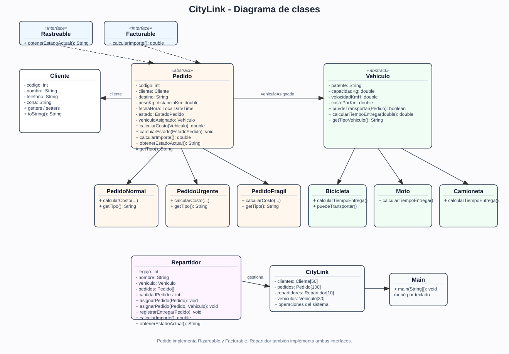
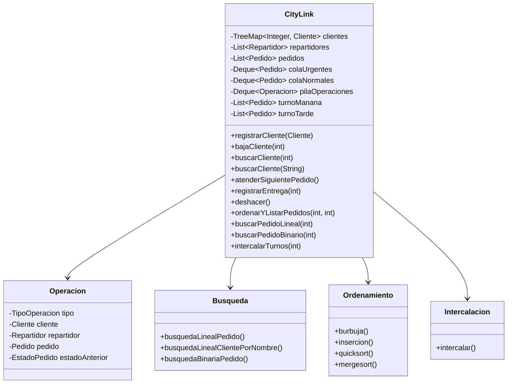

# Proyecto Integrador - CityLink (Entregable 2)

## Integrantes

- Thiago Sturzenegger
- Ángel Ferri
- Walter Rodríguez
- Álvaro Chirino

**Repositorio:** https://github.com/Erebothh/Prog-1

## Qué cambia respecto del Entregable 1

Este entregable parte del sistema anterior, pero cambia los arreglos por las estructuras dinámicas de `java.util` y agrega algoritmos de búsqueda, ordenamiento e intercalación.

Se mantienen:

- El modelo de objetos y la herencia.
- Las interfaces `Rastreable` y `Facturable`.
- El polimorfismo.
- Las excepciones propias.
- Los paquetes `modelo`, `excepciones` y `app`.

Se agrega el paquete `algoritmos`.

## Cómo compilar y ejecutar

```bash
javac -d out $(find src -name "*.java")
java -cp out app.Main
```

Necesitás Java 17 o superior.

## Estructuras usadas

| Estructura | Clase de Java | Para qué la usamos |
| --- | --- | --- |
| Árbol de búsqueda | `TreeMap<Integer, Cliente>` | Clientes ordenados por código |
| Lista | `ArrayList<Repartidor>` | Repartidores |
| Lista | `ArrayList<Pedido>` | Todos los pedidos |
| Lista | `ArrayList<Pedido>` | Historial y pedidos de cada repartidor |
| Pila | `ArrayDeque<Operacion>` | Deshacer la última operación |
| Cola | `ArrayDeque<Pedido>` | Pedidos urgentes |
| Cola | `ArrayDeque<Pedido>` | Pedidos normales |
| Lista | `ArrayList<Pedido>` | Pedidos del turno mañana y del turno tarde |

Las colas se manejan con `offerLast` para agregar al final y `pollFirst` para sacar el primero. Así se respeta el orden de llegada. Primero se atiende la cola de urgentes y, cuando está vacía, la de normales.

La pila se maneja con `push` y `pop` (en realidad usamos `pollFirst`, que saca el último agregado porque `ArrayDeque` funciona como pila).

## Estructuras vacías

Si se elige "Atender el siguiente pedido" y las dos colas están vacías, se lanza:

```java
SinPedidosPendientesException
```

El menú la captura, muestra el mensaje y sigue funcionando. No se cae el programa.

## Algoritmos

Los algoritmos están en el paquete `algoritmos` y fueron escritos a mano. **No usamos** `Collections.sort`, `List.sort` ni `Arrays.binarySearch`.

### Búsqueda lineal

- `Busqueda.busquedaLinealPedido(List<Pedido>, int)`
- `Busqueda.busquedaLinealClientePorNombre(List<Cliente>, String)`

Recorren la lista de principio a fin y comparan. Devuelven `null` si no encuentran nada.

### Búsqueda binaria

- `Busqueda.busquedaBinariaPedido(List<Pedido>, int)` (iterativa)
- `Busqueda.busquedaBinariaPedidoRecursiva(List<Pedido>, int)` (recursiva)

Para usarla, la lista tiene que estar ordenada por código. En el menú, la opción de búsqueda binaria arma una copia de la lista, la ordena con quicksort y busca sobre esa copia. Así no se cambia el orden original de los pedidos.

### Ordenamiento

Hay cuatro algoritmos:

1. Burbuja.
2. Inserción.
3. Quicksort.
4. Mergesort.

Todos reciben un `Comparator<Pedido>` para poder ordenar por:

- Costo.
- Distancia.
- Fecha de ingreso.

### Intercalación

`Intercalacion.intercalar(listaA, listaB, comparador)` recibe dos listas que ya están ordenadas y las combina en una sola con un único recorrido. No vuelve a ordenar.

En el menú se ordenan los pedidos del turno mañana y del turno tarde, y después se intercalan.

## Diagrama de clases



También está el archivo [`docs/diagrama-clases.svg`](docs/diagrama-clases.svg).



El resto del modelo (`Cliente`, `Pedido`, `Vehiculo`, `Repartidor`, sus subclases y las interfaces) es igual al Entregable 1.

## Menú

```text
1. Gestión de clientes
2. Gestión de repartidores
3. Registrar un pedido
4. Atender el siguiente pedido
5. Registrar una entrega
6. Deshacer la última operación
7. Ordenar y listar pedidos
8. Buscar un pedido por código
9. Intercalar pedidos de dos turnos
10. Salir
```

### Submenú de clientes

```text
1. Alta de cliente
2. Baja de cliente
3. Buscar por código
4. Buscar por nombre
5. Listado ordenado por código
0. Volver
```

### Submenú de repartidores

```text
1. Alta de repartidor
2. Listado de repartidores
3. Ver pedidos e historial de un repartidor
4. Ver comisiones
0. Volver
```

## Deshacer

Cada operación importante se apila en `pilaOperaciones`. La opción 6 saca la última y la revierte:

| Operación | Qué hace "Deshacer" |
| --- | --- |
| Alta de cliente | Lo saca del `TreeMap` |
| Baja de cliente | Lo vuelve a insertar |
| Alta de repartidor | Lo saca de la lista |
| Alta de pedido | Lo saca de la lista, de la cola y del turno |
| Asignar pedido | Lo saca del repartidor, lo devuelve a la cola y lo pone en `PENDIENTE` |
| Registrar entrega | La saca del historial y vuelve el pedido a `EN_CAMINO` |
| Cambio de estado | Vuelve al estado anterior |

Para poder volver atrás con los estados agregué el método `restaurarEstado` en `Pedido`. Lo usa solamente "Deshacer"; las transiciones normales siguen validadas por `cambiarEstado`.

## Datos de prueba

El sistema arranca con los mismos datos que el Entregable 1:

- 5 clientes.
- 3 repartidores: bicicleta, moto y camioneta.
- 8 pedidos, con normales, urgentes y frágiles.

Los pedidos 1 y 2 están entregados, el 3 está en camino y los pedidos 4 a 8 están pendientes en las colas. El pedido 5 es urgente, así que es el próximo que se atiende.

## Pruebas documentadas

### Caso normal: listado de clientes ordenado

Entrada: opción `1`, luego `5`.

Resultado esperado: los clientes salen ordenados por código, del 1 al 5, porque el `TreeMap` mantiene las claves ordenadas.

### Caso normal: atender un pedido

Entrada: opción `4`.

Resultado esperado:

```text
Pedido 5 asignado a Jorge Ríos (Camioneta).
```

El pedido 5 es urgente, por eso sale antes que los normales. Se elige un repartidor que pueda transportarlo y que tenga menos carga.

### Caso normal: registrar una entrega

Entrada: opción `5`, código `5`.

Resultado esperado:

```text
Entrega registrada para el pedido 5.
```

El pedido pasa a `ENTREGADO` y se guarda en el historial del repartidor. La comisión se calcula sobre el historial.

### Caso normal: deshacer una entrega

Entrada: opción `6` después de registrar la entrega del pedido 5.

Resultado esperado:

```text
Se deshizo la entrega del pedido 5.
```

El pedido vuelve a `EN_CAMINO` y sale del historial. La comisión vuelve a bajar.

### Caso normal: ordenar por costo con quicksort

Entrada: opción `7`, criterio `1`, algoritmo `3`.

Resultado esperado: los pedidos salen ordenados por costo. Los que no tienen vehículo muestran "sin calcular" y se toman como costo 0 para el ordenamiento.

### Caso normal: búsqueda binaria

Entrada: opción `8`, método `2`, código `5`.

Resultado esperado: se muestra el pedido 5 y su estado. La búsqueda se hace sobre una copia ordenada por código.

### Caso normal: intercalar turnos

Entrada: opción `9`, criterio `1`.

Resultado esperado: se ordenan los pedidos del turno mañana y del turno tarde, y después se muestran intercalados en una sola lista.

### Caso borde: cola vacía

Entrada: atender pedidos hasta que no quede ninguno y elegir la opción `4` otra vez.

Resultado esperado:

```text
Error: No hay pedidos pendientes para atender.
El sistema sigue funcionando.
```

### Caso borde: pila vacía

Entrada: elegir la opción `6` sin haber hecho ninguna operación (la precarga limpia la pila).

Resultado esperado:

```text
Error: No hay operaciones para deshacer.
El sistema sigue funcionando.
```

### Caso borde: cliente inexistente

Entrada: opción `1`, buscar por código un cliente que no existe.

Resultado esperado:

```text
Error: No existe un cliente con el código 99.
El sistema sigue funcionando.
```

### Caso borde: pedido inexistente

Entrada: opción `8`, código `99`.

Resultado esperado:

```text
Error: No existe el pedido 99.
El sistema sigue funcionando.
```

### Caso borde: código repetido

Entrada: registrar un cliente o un pedido con un código que ya existe.

Resultado esperado: mensaje de error, sin modificar los datos.

### Caso borde: un solo elemento

Los algoritmos de ordenamiento tienen en cuenta listas de tamaño 0 o 1:

- `burbuja` no entra al ciclo externo.
- `insercion` no entra al `for`.
- `quicksort` no hace nada porque `izquierda < derecha` es falso.
- `mergesort` corta cuando `size() <= 1`.

La búsqueda binaria también funciona con un solo elemento y devuelve `null` si el código no coincide.

### Caso borde: listas vacías en la intercalación

`Intercalacion.intercalar` funciona si una de las dos listas está vacía: copia la otra completa. Si las dos están vacías, devuelve una lista vacía.

### Caso borde: pedido frágil en bicicleta

`Bicicleta.puedeTransportar` devuelve `false` para un `PedidoFragil`. Si se intenta asignar, se lanza `CapacidadExcedidaException` con el mensaje "Una bicicleta no puede transportar pedidos frágiles."

## Excepciones

Se conservan las cinco excepciones del Entregable 1:

- `ClienteNoEncontradoException` (checked)
- `PedidoInvalidoException` (checked)
- `CapacidadExcedidaException` (checked)
- `AlmacenamientoLlenoException` (checked)
- `EstadoInvalidoException` (unchecked)

Además se agrega:

- `SinPedidosPendientesException` (checked)

El menú captura las excepciones y sigue funcionando. También se mantiene el bloque `finally` al salir.

## Declaración de uso de IA

Para este entregable se usó **OpenCode** (agente de IA con el modelo **Big Pickle**) como apoyo para ordenar ideas, revisar errores de compilación y contrastar los resultados de las pruebas.

El código fue compilado, ejecutado y verificado por el grupo antes de la entrega.
